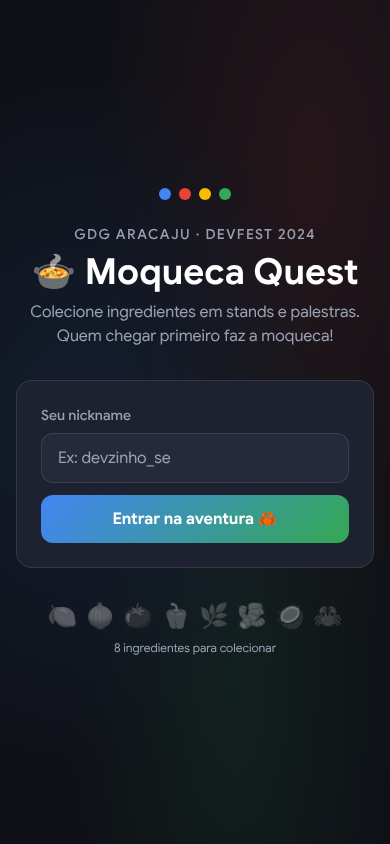
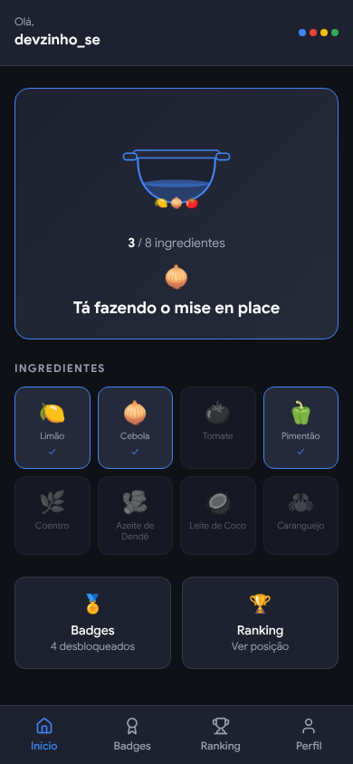
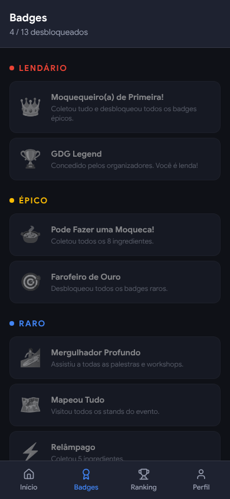
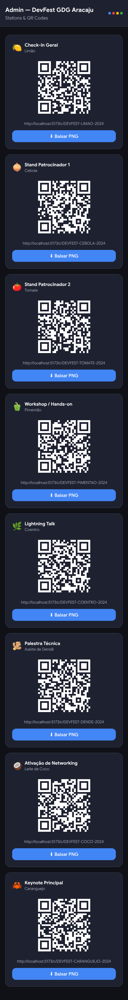
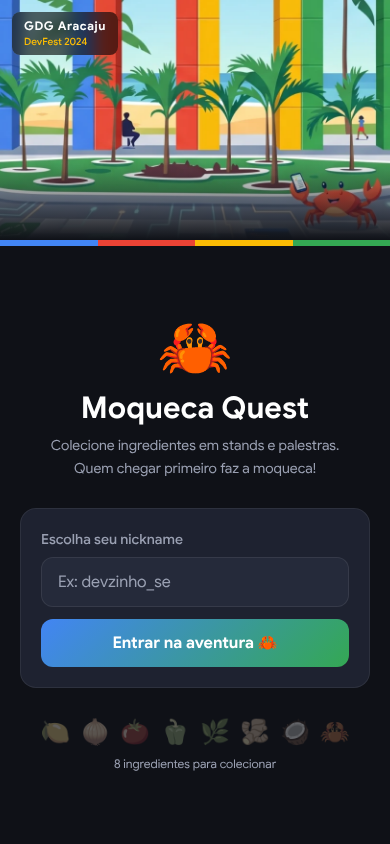
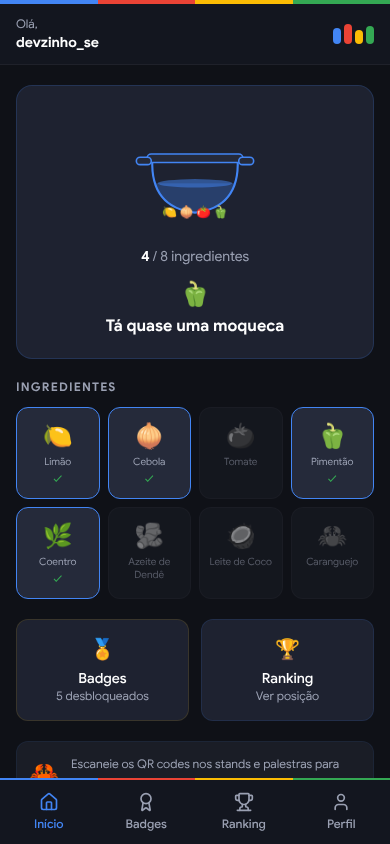
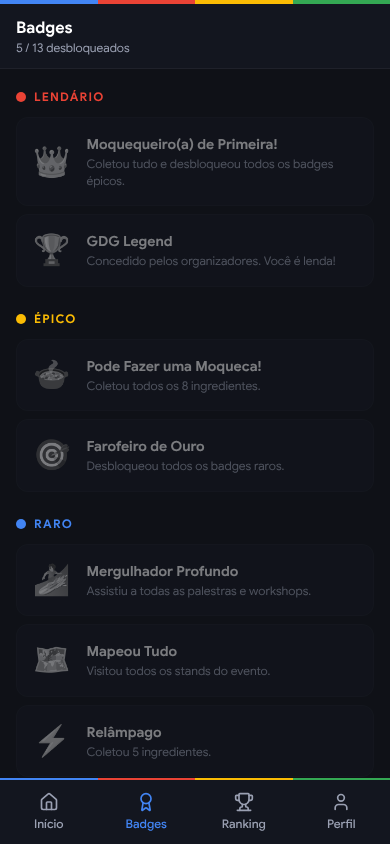
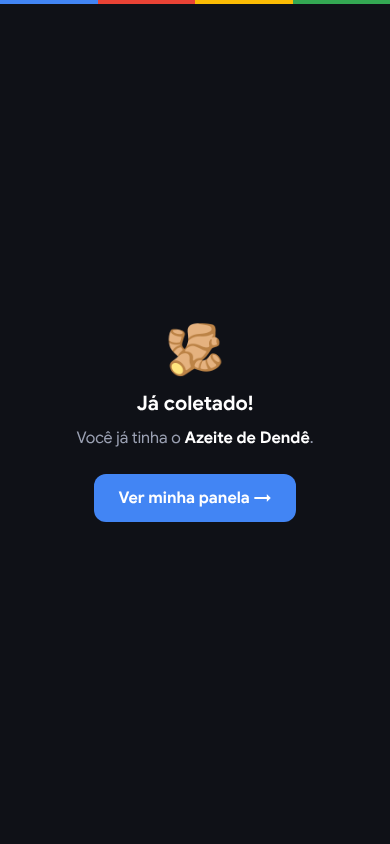
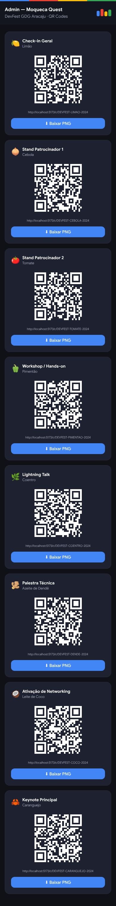

# 🦀 Moqueca Quest — DevFest GDG Aracaju

Plataforma de gamificação para o **DevFest GDG Aracaju**. Participantes coletam ingredientes de uma moqueca de caranguejo visitando stands e assistindo palestras. Quem reunir todos os 8 ingredientes pode fazer a moqueca — e sobe no ranking!

> Inspirado no [Git City](https://www.thegitcity.com/). Identidade visual com a paleta oficial do Google Developer Groups.

---

## Screenshots

> **Discussão em aberto:** temos dois proposals de design. Comente na PR qual você prefere ou sugira melhorias antes de fazermos o merge.

### Opção A — Design atual (dark + paleta GDG)

| Entrada | Panela | Badges | Admin |
|---|---|---|---|
|  |  |  |  |

### Opção B — Design com arte GDG Aracaju (proposta)

Incorpora a arte oficial da comunidade como hero, faixa das 4 colunas coloridas em todas as telas e logo de colunas em miniatura no header.

| Entrada | Panela | Badges | Coleta | Admin |
|---|---|---|---|---|
|  |  |  |  |  |

---

## Como funciona

Cada stand ou palestra do evento tem um **QR code único**. Ao escanear, o participante ganha um ingrediente. Com todos os ingredientes, faz a moqueca e aparece no topo.

### Ingredientes

| # | Ingrediente | Stand / Palestra |
|---|---|---|
| 1 | 🍋 Limão | Check-in geral |
| 2 | 🧅 Cebola | Stand patrocinador 1 |
| 3 | 🍅 Tomate | Stand patrocinador 2 |
| 4 | 🫑 Pimentão | Workshop / hands-on |
| 5 | 🌿 Coentro | Lightning talk |
| 6 | 🫚 Azeite de Dendê | Palestra técnica |
| 7 | 🥥 Leite de Coco | Ativação de networking |
| 8 | 🦀 Caranguejo | Keynote principal |

### Status de moqueca

| Ingredientes | Status |
|---|---|
| 1 | 🍋 Chegou com vontade |
| 2–3 | 🧅 Tá fazendo o mise en place |
| 4–5 | 🫑 Tá quase uma moqueca |
| 6–7 | 🦀 Só falta o caranguejo! |
| 7 (sem 🦀) | 🥥 Falta o principal! |
| 8 | 🍲 Pode fazer uma moqueca! |

### Badges e raridade

12 badges desbloqueáveis em 5 níveis de raridade:

| Raridade | Cor | Exemplos |
|---|---|---|
| Comum |  Cinza | Presença confirmada, 1º ingrediente |
| Incomum |  Verde | Mise en place (3 itens), Networker |
| Raro |  Azul | Mapeou tudo, Relâmpago |
| Épico |  Amarelo | Pode fazer uma moqueca! |
| Lendário |  Vermelho | Moquequeiro(a) de primeira! |

---

## Tech stack

| Camada | Tecnologia |
|---|---|
| Framework | React 19 + Vite 8 + TypeScript |
| Estilo | Tailwind CSS v4 (CSS-first) |
| Roteamento | React Router v6 |
| Persistência | `localStorage` (MVP — sem backend) |
| Ícones | Lucide React |
| QR codes | `qrcode` |
| Deploy | Vercel / Netlify / GitHub Pages |

> **MVP sem backend.** Toda a state do participante fica em `localStorage`. A migração para Supabase está prevista — a camada `src/lib/storage.ts` abstrai o acesso para facilitar esse passo.

---

## Rodando localmente

### Pré-requisitos

- Node.js 18+
- [pnpm](https://pnpm.io/installation)

### Instalação

```bash
git clone https://github.com/laysaalves/codejam-gdg-halloween.git
cd codejam-gdg-halloween
pnpm install
pnpm dev
```

Abra [http://localhost:5173](http://localhost:5173).

### Build de produção

```bash
pnpm build
pnpm preview
```

---

## Estrutura do projeto

```
src/
├── lib/
│   ├── tokens.ts        # Stations, tokens e mapa de QR codes
│   ├── game-logic.ts    # Status de moqueca, badges e raridades (sem I/O)
│   └── storage.ts       # Abstração de localStorage (getPlayer, collectStation…)
├── pages/
│   ├── Home.tsx         # /  — entrada com nickname
│   ├── App.tsx          # /app — panela + ingredientes
│   ├── Badges.tsx       # /app/badges
│   ├── Ranking.tsx      # /app/ranking
│   ├── Profile.tsx      # /app/profile
│   ├── Redeem.tsx       # /c/:token — resgate de QR code
│   └── Admin.tsx        # /admin — gerador de QR codes
├── components/
│   ├── MoquecaPot.tsx   # Panela SVG animada
│   └── NavBar.tsx       # Navegação inferior
├── types/index.ts
└── router.tsx
```

---

## Contribuindo

Contribuições são bem-vindas! Leia as orientações abaixo antes de abrir um PR.

### Fluxo de contribuição

1. Faça um fork do repositório
2. Crie uma branch a partir de `main`:
   ```bash
   git checkout -b feat/minha-feature
   ```
3. Faça suas alterações e escreva um commit descritivo
4. Abra um Pull Request descrevendo o que mudou e por quê

### O que precisa de ajuda

- [ ] **Supabase** — migrar `src/lib/storage.ts` para persistência real com ranking global em tempo real
- [ ] **Scanner de câmera** — implementar `src/pages/Scan.tsx` com `html5-qrcode` ou `@zxing/browser`
- [ ] **Animações** — adicionar Framer Motion nas transições de ingrediente e celebração
- [ ] **Admin com senha** — proteger `/admin` com uma senha simples (env var)
- [ ] **PWA** — adicionar `vite-plugin-pwa` para funcionar offline e ser instalável
- [ ] **Testes** — cobertura de `src/lib/game-logic.ts` com Vitest
- [ ] **i18n** — suporte a inglês para eventos internacionais

### Convenções

- TypeScript estrito — sem `any`
- Componentes funcionais com hooks
- Lógica de jogo **pura** em `src/lib/game-logic.ts` (sem `localStorage`, sem React)
- Estilos inline com a paleta GDG ou classes Tailwind — não criar novos arquivos CSS
- Commits no formato `feat:`, `fix:`, `chore:` (Conventional Commits)

### Configurando os QR codes

Os tokens de cada station ficam em `src/lib/tokens.ts`. Para personalizar para o seu evento, edite o array `STATIONS` — cada entrada tem `id`, `name`, `ingredient` e `token`. Depois acesse `/admin` para gerar os QR codes prontos para imprimir.

---

## Licença

MIT — fique à vontade para usar e adaptar para outros eventos GDG.

---

Feito com 🦀 pela comunidade GDG Aracaju.
